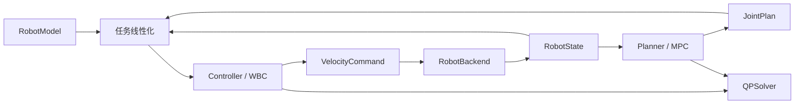

# WholeBodyX 功能与算法设计

## 定位和当前范围

WholeBodyX 负责统一契约、任务构造、算法适配和控制链路。自有 WBC/MPC 仓库继续
维护各自算法；本仓库提供可运行、可对比的参考实现。C++ 和 Python 均可独立实现控制器与规划器。
参考依据见 [开源调研](open_source_references.md)。

首批范围：固定基座、标量欧氏关节、速度命令、加权运动学 WBC、线性关节 MPC、
确定性积分仿真。数学内核同时提供 C++ 和 Python；任务和模型便利接口目前位于 Python。

| 功能 | 当前状态 | 实现位置或下一步 |
| --- | --- | --- |
| 状态、关节限位、线性任务、求解结果 | C++ / Python 已实现 | `control.hpp` / `types.py` / `qp.py` |
| WBC 问题构造及 OSQP 求解 | C++ / Python 已实现 | `control.cpp` / `wbc.py` |
| 关节空间 MPC、参考采样与 warm start | C++ / Python 已实现 | `control.cpp` / `mpc.py` |
| 未消元稀疏关节 MPC | C++ / Python 可选实现 | `sparse_mpc.cpp` / `sparse_mpc.py`；线性规模矩阵存储 |
| 末端位置、末端姿态、关节姿态任务 | Python 已实现，结果可交给任一 WBC | `tasks.py` |
| 世界坐标下双手相对位置、末端速度前馈 | Python 已实现 | `tasks.py` / `experiments.py` |
| 平面双臂 FK/Jacobian | Python 已实现 | `model.py`；2 × 3R 测试模型 |
| URDF / Pinocchio | 可选 Python adapter 已实现 | 固定基座、每关节 `nq=nv=1` |
| 原生 Python API 与可选 C++ 扩展 | 已实现 | `native.py` / `bindings/module.cpp` |
| 按关节名进行后端顺序适配 | C++ / Python 已实现 | `joint_order.hpp` / `joint_order.py`；状态、限位、任务列、命令和计划 |
| 速度积分仿真、多频率闭环 | 已实现 | `simulation.py` / 两种语言示例 |
| 同步 MPC 参考调度与接收校验 | C++ / Python 已实现 | `reference.hpp` / `runtime.py`；过期、覆盖范围、预测偏差、失败处理 |
| 可注入模型与驱动的速度执行 | Python 已实现 | `execution.py`；组合 MPC、额外任务和命令门控 |
| 力矩执行与固定接触仿真 | 实验性 Python 实现 | `torque.py` / `dynamics_simulation.py`；独立动力学校验 |
| 浏览器 3D 与实时诊断曲线 | 已实现 | Viser + uPlot；`visualization/` |
| 自有 WBC/MPC 仓库接入 | 独立后端注册、运行器和诊断已实现；具体 adapter 待仓库确定 | `backends.py` / `runner.py` / `diagnostics.py` |
| 硬件驱动、ROS/MuJoCo adapter | 待实现 | 明确机器人接口后接入 |
| 浮动基座动力学 WBC、恒高质心/ZMP MPC | 实验性 Python 实现 | `dynamics.py` / `centroidal.py`；固定双脚接触，见 [H1 指南](h1_dynamics.md) |
| 严格任务优先级、碰撞 | 待实现 | 独立 formulation 和约束接口 |
| 非线性 MPC、接触切换 | 待实现 | 专用预测模型与接触调度 |
| 独立进程关节 MPC 与参考交换 | 可选 Python 实现 | `process_mpc.py` / `async_runtime.py`；有界队列、未来状态预测、显式种子与故障锁存 |
| 确定周期部署 | 待实现 | 独立处理操作系统、设备驱动、内存与调度边界 |

## 仓库和接口边界

Python OSQP 的变量缩放采用 `x=D*z`，上三角 Hessian 转换为 `D*H*D`，
约束转换为 `A*D`。缩放后的 CSC 必须在记录结构、初始化及更新之前使用同一排序。
适配器直接缩放自有 CSC 数值，合并重复坐标、清除下溢形成的零项，并验证转换有限性；
独立可行性复核继续使用原始物理坐标与绝对 `1e-6` 阈值。
Python `OSQPSolver(normalize_constraints=True)` 可先按原始 A 每行最大绝对系数
同时除 A 和上下界，再执行变量缩放；全零行的除数为 1。该选项默认关闭，
不改变公开 QP、warm start 或结果的物理单位。行除数和缩放后的 CSC 随 A 缓存，
只有边界或 Hessian 改变时不重新计算行尺度，reset 清除缓存。
按行相除发生有限值溢出或非零值下溢为零时，在更新工作区之前抛出 `ValueError`；
原始 A 与边界仍用于独立的物理残差验收。
Python `OSQPSolver` 与两个 C++ 适配器的原始/对偶不可行性判据默认均为 `1e-8`；Python 允许通过
`eps_prim_inf` / `eps_dual_inf` 单独配置，以避免弱约束被 OSQP 较宽的默认判据提前误判。
默认 Python/原生稀疏 MPC 对复用工作区的不准确或迭代上限至多冷重试一次，
累计两次迭代，仍要求严格 solved 和独立物理复核；显式传入或替换的 Python 求解器维持单次调用。
不同比例、不同上下界及变化约束使用独立 KKT 最优解和物理残差验收；
复现入口见 [验证方法](validation.md)。

`formulate()` 只构造问题；`QPSolver.solve()` 只求解；控制器/规划器负责解释结果。
算法库不依赖硬件或仿真。`Controller` / `Planner` 是 C++ 抽象类和 Python Protocol；
Python 原生实现不依赖本项目的 native 扩展。C++ 程序构建时可以关闭 Python 绑定。

自有仓库接入时，在 WholeBodyX 一侧实现 adapter：

1. 转换状态顺序、单位、坐标系和时间信息。
2. 将通用任务/目标转换为原库支持的输入，明确拒绝不支持的能力。
3. 转换求解状态、结果和参考有效期。
4. 通过公共契约测试及同一机器人闭环示例验证。

`BackendRegistry` 统一创建 Python/native 及自定义后端。工厂分别注册 controller/planner，
每个 session 使用自己的注册表快照和算法实例。无界面执行与浏览器共用包内 `session.py`，
统一命令与自定义工厂示例见 [接入说明](integration.md)。

本版 `Controller` 接收线性任务，适用于速度控制。动力学 WBC 使用独立的
`DynamicsController`、`DynamicsState`、`CoMReference` 与 `TorqueCommand`。
通用执行边界及迁移方法见 [执行接口](execution.md)。同样，`JointPlan` 是本版
关节积分模型的参考类型；非线性预测、反馈策略及接触力参考需要新的明确类型。

## 数据契约

- 所有关节数组使用 `RobotModel.joint_names` 顺序，单位为 SI；适配时建立一次索引映射。
  每条状态不重复携带字符串。第一版同一运行实例只关联一个机器人模型。
  后端内部可以使用不同排列，进出边界由 `JointOrder` 转换；原始求解器决策向量保留其内部排列。
  说明与闭环验证见 [关节顺序适配](joint_order.md)。
- `RobotState(q, v, stamp)` 要求有限、非空且 `q/v` 同维。时间戳来自同一单调时钟。
  状态/命令时间戳及执行周期转为 Python `float`，避免 NumPy `float32` 标量
  将较大时间戳与小步长的运算降为单精度；输入已经丢失的时间精度无法恢复。
  此契约不承载浮动基座或连续关节的非欧氏配置；实验模块使用独立的 `DynamicsState`。
- `Pose` 包含三维位置和 SO(3) 旋转矩阵。Jacobian 对应末端原点，以世界方向表达，
  六行依次为线速度、角速度。
- `JointLimits` 包含有限位置上下界、正速度上界和可选速度变化率上界。
  当前的 acceleration 字段约束离散速度差，是运动学约束，不代表动力学可实现性证明。
  配置 acceleration 后，`velocity_bounds()` 还限制最大制动轨迹的离散积分位移，
  避免当前一步合法、下一步因位置与速度差约束冲突而不可行。制动边界附近仅合并
  由位置减法舍入引起的微小反向区间；明确矛盾的边界仍返回不可行。
  WBC 将已求解结果在 `1e-6` 验收范围内的速度盒残差归一到精确边界，再生成命令；
  超过该范围或无效的解不产生命令。MPC 的终端可停止性和动力学可实现性仍需单独约束。
- `VelocityCommand` 有明确的生成时间和有效区间；后续增加位置或力矩命令时使用独立类型。
- `JointPlan` 包含 N+1 个位置节点、N 个区间速度、起始时间和固定间隔。
  有效域为 `[stamp, stamp + N*dt)`；区间内线性插值位置并保持该区间速度。
  不延长过期参考，也不将超出有效期的采样静默截到最后一个点。
  内部节点附近 4 ULP 内对齐到节点并选用右侧区间速度；过大时间戳导致步长不可区分时拒绝计划。
- Python 输入数组在构造时复制并设置为只读；native adapter 返回 Python 值对象，
  不泄露求解器工作区。每个规划/控制循环拥有独立的模型 Data 和求解器实例。

## 速度级 WBC

优化变量为关节速度 `v_cmd`。每个任务给出 Jacobian `J_i`、目标速度 `b_i` 和非负权重 `W_i`：

$$
\min_v \frac12\sum_i(J_i v-b_i)^T W_i(J_i v-b_i)
+\frac{\lambda}{2}\|v\|^2
+\frac{\eta}{2}\|v-v_{measured}\|^2.
$$

`lambda > 0` 用于正则化；`eta >= 0` 是可选平滑项。所有任务组成一个加权目标，
权重并不提供严格的字典序优先级。

任务实现：

| 任务 | `J` | `b` |
| --- | --- | --- |
| 关节姿态 | 单位阵 | `v_ff + K(q_target - q)` |
| 末端位置 | 位置 Jacobian | `K(p_target - p)` |
| 末端姿态 | 六维几何 Jacobian | `twist_ff + K[p_target-p; Log(R_target R^T)]` |
| 双手相对位置（世界坐标） | `J_right[:3] - J_left[:3]` | `K[relative_target - (p_right-p_left)]` |

姿态任务使用 SO(3) 对数作为世界方向的旋转纠偏速度，属于局部任务控制；
不将其描述成全局逆运动学求解或完整 SE(3) 残差的 Newton 步。

硬约束由以下范围取交集：

$$
-v_{max}\le v\le v_{max},\qquad
\frac{q_{min}-q}{\Delta t}\le v\le\frac{q_{max}-q}{\Delta t}.
$$

有速度变化率限制时再加入：

$$
v_{measured}-a_{max}\Delta t\le v\le v_{measured}+a_{max}\Delta t.
$$

实现形成 `H = sum(J.T W J) + (lambda+eta) I`、
`g = -sum(J.T W b) - eta*v_measured`，使用统一 QP
`min 0.5*x.T H x + g.T x, lower <= A*x <= upper`。

Python WBC 将首次或变化后的 H/A 复制到 bytes 支撑的不可写缓冲区，完成实际动态向量、
有限性、对称性和半正定检查后，供求解器复用这次验证。只有新算出的 Hessian 数值完全相等
时才复用模板；任务雅可比、权重及控制设置引起的变化均重新验证。
`formulate()` 仍返回稠密 `QuadraticProgram`，每次的数组元数据和动态向量独立。
返回的 H/A 不能用 `setflags(write=True)` 恢复写权限；普通公开构造的 QP 仍在求解时检查修改。

稠密和稀疏固定 QP 共享向量快照与矩阵验证凭据的管理，矩阵表示分别提供不可写存储和独立元数据视图。
替换 Hessian 保留约束原凭据；返回问题的矩阵元数据变化不会影响下一次构造的问题。
稀疏视图浅复制已验证的 CSC 封装，并分别复制三个数组的元数据；稀疏形状和排序标志同样独立。

原生稀疏 MPC 在复用工作区时，如果 OSQP 返回不准确解或迭代上限，至多清空状态并冷重试一次。
冷启动本身的收敛失败、不一致边界、无效输入及物理验收失败均直接拒绝。
重试仍要求严格 `solved`、独立物理违反不超过 1e-6，迭代数包含两次尝试；detail 记录恢复原因。
该策略增加了有界的最坏规划开销，不构成硬实时保证；执行链路的超期锁存与参考清除继续生效。

动态 Python WBC 在替换 Hessian 时共享已验证的不可写约束数据，避免重复构造单位矩阵。
`_FixedQP.with_hessian()` 验证新 Hessian 和当前向量，并保留约束原有的验证凭据。
公开问题与模板各自持有独立数组元数据；求解器仍检查实际存储与凭据是否一致。
约束的元数据发生变化时不能获得新的免验证凭据，修改后的矩阵仍需通过求解器验收。
关节维度变化时重新构造相应大小的单位约束；固定 Hessian 路径保持原有向量更新方式。

稠密 QP 的有限 float64 Hessian 使用最大绝对转置差检查对称性，仍采用 1e-10
绝对容差；构造前的有限值检查、Cholesky 与特征值回退保持不变。
调用方修改为其他 dtype 的存储仍采用通用比较，避免整数减法溢出绕过检查。
这些检查同时用于公开 QP、动态 WBC 模板及修改后矩阵的重新验收。

Python OSQP adapter 为稠密 Hessian 的上三角 CSC 保存一份不可写索引模板。
只有原非零位置仍全部非零、且总非零数相等时才复用；同数量的位置交换也会重新构造。
模板只保存最近转换的稠密结构索引，不保存问题数值；转换稀疏 Hessian 及求解器复位清除该模板。
同一结构复用空 CSC 封装，返回矩阵的数值重新提取，索引使用独立视图。
此优化发生在输入矩阵验收之后，变量缩放仍作用于独立的 CSC 数值。
界限冲突返回 infeasible。约束在优化中处理，不用解后的简单限幅替代约束求解。

## 关节空间 MPC

两种 Python 关节 MPC 共用配置访问、历史速度平移、reset 和计划重建验收，
各自保留消元 / 未消元矩阵布局及求解策略。所有成功解仍经独立的物理限位复核，
失败结果不替换上一条成功计划。原生适配器共用 reset 和结果转换；
C++ 消元 / 稀疏入口共用 OSQP 基础设置和失败状态映射，稀疏入口仍单独设置调节间隔。

本版采用速度输入的离散积分模型：

$$q_{k+1}=q_k+h u_k.$$

给定常值关节目标 `q_goal`，代价为：

$$
\frac12\sum_{k=1}^{N-1}\|q_k-q_{goal}\|_Q^2
+\frac12\|q_N-q_{goal}\|_{Q_f}^2
+\frac12\sum_{k=0}^{N-1}\|u_k\|_R^2.
$$

实现中 Q、Qf、R 为正标量乘单位阵，N=1 时只有终端状态代价。
对预测位置 `q_1..q_N`、速度 `u_0..u_{N-1}` 添加硬约束；可选加入
`|u_0-v_measured| <= a_max*h` 及 `|u_k-u_{k-1}| <= a_max*h`。
目标是软目标，因此目标超出关节范围仍可求得范围内的最优预测。

默认 `JointMPC` 消去状态，令 `U = [u_0; ...; u_{N-1}]`：

$$X=\mathbf 1\otimes q_0 + S U,$$

其中 `S` 为下三角块矩阵，非零块为 `h I`。由此得到带位置、速度及差分约束的 QP。
上次成功计划按经过的预测节点数平移，末尾保持最后区间速度作为 warm start。
两种语言的消元规划器均以 CSC 保存固定模型，存储为 `O(nN²)`；
Python 按时间权重与关节误差直接生成梯度，每次更新 `g/l/u`。
Python 的公开 `formulate()` 及自定义求解器继续使用稠密问题，首次请求时缓存稠密 H/A；
`fixed_matrix_bytes` 同时计入已请求的稠密缓存。默认求解只使用压缩模型。
内置求解器的子类、实例替换方法及规划器的 `formulate()` 重载仍走公开接口。
`reset()` 同时清除计划和求解器工作区，保留固定模型矩阵。配置参数在构造后保持不变，
修改预测间隔、权重或限位时创建新的规划器。

可选 `SparseJointMPC` 保留 `q_1..q_N` 和 `u_0..u_{N-1}`，通过局部积分等式连接
相邻节点。代价和限位与默认规划器相同，H/A 以不可变 CSC 存储；矩阵存储随关节数与
预测步数的乘积线性增长。小问题可能没有速度收益，配置方式与测量见
[执行接口](execution.md) 和 [性能记录](performance.md)。

输出预测只对该积分模型成立。WBC 叠加其他任务或受更紧约束影响时，实际轨迹可以偏离预测；
因此 MPC 每次以最新状态重规划。本版没有终端不变集或递归可行性证明。

## 求解与运行

Python 与 C++ 均提供 OSQP adapter，稀疏结构不变时更新已有工作区。严格接受
`solved`，并检查结果有限及最大绝对约束违反不超过 `1e-6`。
`solved inaccurate`、不可行或迭代耗尽不会产生可执行命令/参考。
接口返回状态和原因，由运行层决定处置；仿真示例在失败时结束并报告异常。

Python adapter 将 OSQP 设置、更新、预热和求解调用抛出的数值异常转换为 `error`，并清空工作区。
这同时兼容 OSQP 1.0 的 `ValueError` 和后续版本的 `OSQPException`。调用方数据校验抛出的
`ValueError` 继续向上传递，且不清除原有健康工作区；异常转换仅包围后端调用。

H/A 数值完全相同时只更新向量，数值变化时更新矩阵，结构变化时重建工作区。
固定矩阵的凸性校验可以复用；动态向量及结果验证仍在每次求解中执行。
性能数据与复现入口见 [性能记录](performance.md)。

示例控制周期为 0.02 s，MPC 默认每 0.1 s 按状态时间重算，预测间隔为 0.1 s。
目标变化、预测偏差超过阈值或有效期不足时提前重规划。Python 示例使用独立
`MPCReferenceManager` 检查结果状态、起点、时间覆盖和关节约束，失败时清除旧计划。
完整策略及状态偏移示例见 [运行模块说明](runtime.md)。
这些是仿真时间参数，不是实时性能承诺。默认 MPC 使用压缩固定模型，但整体仍有动态分配
和输入检查，未验证最坏执行时间。后续确定周期运行需要独立处理预分配、任务结构固定、
调度、通信、超时及硬件失效行为。

Python 的同步、异步与进程交换复用 `mpc.py` 中的计划接收校验，统一复制快照、起始状态、
完整控制区间以及位置、速度和加速度限制检查。进程交换不再创建同步参考调度器来校验一份计划。
速度和力矩执行复用累计预算判定；两种循环各自保留时钟读取、命令门控和故障恢复状态。

Python 调度可以组合 Python 或 native WBC/MPC。native 求解调用释放 GIL，
但同一个求解器实例不能被多个线程并发调用。Python 共同执行锁覆盖 Python OSQP 求解和
完整的 native 数值绑定调用，后者包括 C++ 问题构造与结果复核。C++ 直接入口另在 OSQP
内核处互斥，以保护固定依赖版本的进程级中断监听状态；等待时间计入执行预算。
未来跨进程部署应发送有版本的数值快照，
包括模型标识、时钟域、序号、生成时间和有效区间，运行层检查后再发布新参考。

普通 Python QP 的数组只读标志可被调用方逆转，因此求解器在输入变化后重新检查
凸性、对称性、有限值与尺寸。只读模板记录经过验收的不可写存储与视图元数据，
只有完全匹配才跳过矩阵复验；后续仍核对动态向量和物理残差。
复现方法与性能边界见 [性能说明](performance.md)。

## 构建和依赖

- C++：Conan 2 + CMake，导出 `wholebodyx::wholebodyx`。
  本版 profile 显式选择 GCC 12，避免 profile 声称的编译器与实际执行程序不一致。
- Python：独立 `wholebodyx` 包，NumPy/SciPy/OSQP 由 uv 管理。
  这里“Python 原生实现”指问题构造与调度用 Python，数值依赖仍可包含编译代码。
- 可视化：`viz` extra 安装 Viser，场景与 uPlot 曲线消费控制状态，不引入 C++ 构建依赖。
  详见 [可视化设计](visualization.md)。
- URDF：`urdf` extra 使用 Pinocchio 3.x；同时约束 cmeel-urdfdom 4.x 和
  cmeel-tinyxml2 10.x，匹配本次验证的二进制依赖，避免解析到不兼容的新 ABI。
- native：单独的 `wholebodyx-native` 扩展包，pybind11 + scikit-build-core。
  构建脚本将唯一一份 C++ 源码整理为自包含源码分发包；没有在两个目录复制维护核心代码。
- `conan.lock` 与 profile 共同确定 C++ 依赖配置；`uv.lock` 确定 Python 解析结果。
  两个锁文件不替代编译器安装，也不保证全部平台 ABI 兼容。
- 当前 native wheel 面向构建机平台，尚未进行多平台 wheel 修复/发布。
  扩展使用静态核心和当前静态 OSQP 包；Python 侧 Pinocchio 对象不跨 native 边界。

## 后续算法顺序与验收

1. 接入自有仓库：提供 CMake target / Conan recipe 或 Python 包，完成 adapter，
   用固定输入、不可行输入和双臂闭环验证兼容性。
2. 机器人适配：真实双臂 URDF、模型关节顺序、控制模式和仿真后端；验收 FK/Jacobian、
   命令频率、限位与跟踪误差。Python URDF adapter 目前没有 C++ 对等便利封装。
3. 动力学 WBC：实验实现变量为 `a, f, tau`，约束
   `M(q)a+h(q,v)=S.T*tau+Jc.T*f`、`Jc*a+Jdotc*v=0`，加入力矩及摩擦约束。
   已验证固定接触的动力学残差、接触约束残差及力矩范围；后续接入实机驱动与独立仿真器。
4. 严格层级任务：独立分层求解策略，测试低优先级任务不会改变高优先级最优值。
5. 非线性 MPC：通过已有库适配动力学、代价、导数与接触计划，先验证预测 rollout 和
   实际闭环的一致性，再扩展浮动基座。需要区分配置空间维度与切空间维度。

当前测试包括解析小问题、耦合约束最优解、不可行性、参考有效期、有限差分 Jacobian、
两种语言的 QP 矩阵/结果一致性、双臂闭环、固定接触动力学以及 C++ 包消费。
真实硬件、接触切换和碰撞不在当前验证范围。
