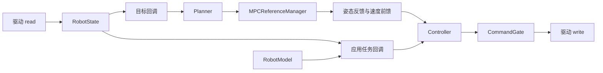
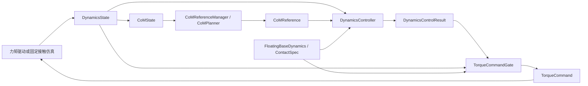

# 可注入模型、算法和执行后端的运行组件

`TrackingSession` 继续服务内置平面双臂场景和浏览器。应用需要替换机器人、
增加任务或接入驱动时，可使用 `VelocitySession`；动力学接口使用独立的
`TorqueControlLoop`。执行组件由单个所有者线程串行调用；速度会话还可以显式注入
下述独立进程参考管理器。调用方负责周期调度。

## 速度控制组合



以下示例可以在安装后的 Python 环境中运行，不依赖 `examples/` 或界面：

```python
import numpy as np
from wholebodyx import BackendRegistry, RobotState, VelocitySession
from wholebodyx.model import PlanarDualArm
from wholebodyx.simulation import JointIntegrator
from wholebodyx.tasks import FramePositionTask

model = PlanarDualArm()
goal = np.array([.5, .4, -.3, -.5, -.4, .3])
initial = RobotState([.2, .6, -.4, -.2, -.6, .4], np.zeros(6))
target = model.pose(goal, "left_ee").translation
driver = JointIntegrator(model.limits, initial, control_dt=.02)
registry = BackendRegistry()

def tasks(model, state):
    return [FramePositionTask("left_ee", target).linearize(model, state)]

session = VelocitySession(
    model, driver,
    registry.create_controller("python", model.limits),
    control_dt=.02,
    planner=registry.create_planner("sparse", model.limits),
    task_factory=tasks,
    posture_weight=.1,
)
session.reset()
for _ in range(250):
    step = session.step(goal)
    # step.cycle: 状态、控制结果、control_ms、cycle_ms。
    # step.reference: 本次参考、重规划原因和规划耗时。
```

将 `model` 换成 `PinocchioModel(urdf)`，并按该模型构造初值和任务，就能使用相同的
运行组件。可执行的单臂例子：

```bash
uv run --extra urdf python examples/python/urdf_tracking.py
uv run --extra urdf python examples/python/urdf_tracking.py --mpc --mpc-backend sparse
PYTHONPATH=build/native uv run --extra urdf python examples/python/urdf_tracking.py \
  --backend native --mpc --mpc-backend python --backend-joints wrist_joint shoulder elbow
```

### 周期输入与故障行为

- `task_factory(model, state)` 返回额外的 `LinearTask` 列表或元组。
  有规划器时，这些任务与采样得到的姿态任务一起进入 WBC。
- `step(goal)` 的目标可为数值数组，也可为 `goal(state)` 回调。
  回调在本周期唯一一次驱动读取后执行，适合按测量时间生成目标。
- 不配置规划器时，使用 `step()`，由任务回调提供 WBC 目标。
- `limits=` 可覆盖模型限位，例如应用自己的速度上限；维度必须匹配模型关节数。
- `max_cycle_time=` 是完整周期的可选墙钟预算，包含规划和任务回调。
  检查发生在调用边界，无法抢占阻塞 I/O 或求解器。
- 读状态、构造任务、规划、求解、校验或下发失败时，驱动停机一次，故障锁存，参考失效。
  再次 `step()` 不会继续读写驱动；修复问题后必须 `reset()`。
- `reset()` 复位规划器、控制器和门控；任一算法复位失败仍停机并保持故障。
  它不复位机器人、不回退设备时间，也不自动恢复被移动的关节位置。
- 运行组件只保留当前计划、最后一次参考和累计步数，不积攒历史轨迹。

执行预算拒绝仍以原有 `RuntimeError` 故障形式抛出，其 `__cause__` 现在保留
`ExecutionDeadlineError`。可在故障处理路径读取 `exc.__cause__.as_dict()`，
先用 `isinstance(exc.__cause__, ExecutionDeadlineError)` 检查类型。
字典包含 `mode`、`stage`、累计 `elapsed_s`、实际 `budget_s` 与 `write_completed`。
检测边界为 `after_read`、速度管线的 `after_tasks` / 力矩管线的 `after_reference`、
`before_write`、`after_write`。它表示在哪个边界检测到超时，不提供每阶段耗时，
也不能仅凭该边界将原因归结为某个算法或操作系统调度。

`write_completed=True` 只表示驱动 `write` 方法已正常返回，不确认实际执行器动作或设备应答。
预算仍取配置周期预算与命令有效时长的较小值，原有判定、一次停机和故障锁存行为保持不变。
无效墙钟的非有限累计值在 JSON 中用 `null` 和 `elapsed_finite=False` 表示，便于严格 JSON 保存。

`JointIntegrator(control_dt=...)` 已满足速度驱动的 `read/write/stop` 形状；原来的
`write(command, dt)` 仍可使用。配置周期后若显式传入不同的 `dt`，会拒绝执行。
真实设备仍需实现驱动、时间戳映射、传感数据年龄检查和设备端看门狗。

## 独立进程关节 MPC

`ProcessMPCWorker` 在 `spawn` 子进程中运行内置 `python`、`native`、`sparse`
或 `native-sparse` 关节规划器。父进程的 relay 线程负责全部管道收发、结果快照和物理校验；
控制线程的 `submit/poll/cancel` 不等待管道、求解器或被占用的 relay 锁。
每个 worker 最多保留一个在算请求、一个可替换的待算请求和一个最新完成结果。
输入复制后独立保存；目标更新和复位通过 generation/sequence 隔离旧结果。
`cancel/reset` 隔离结果，不抢占正在执行的优化；需要中止求解时，在控制周期外关闭并重建 worker。
父进程的复位立即隔离旧结果，子进程在下一代请求求解前复位算法；该复位若失败，后续周期
会收到 worker 错误并锁存故障。

`AsyncMPCReferenceManager` 预测当前有效轨迹在 `lookahead` 之后的状态，并提交该未来状态。


前瞻的名义起点向上对齐到完整控制周期，最多允许 4,096 个预测控制周期。为兼容逐周期累加
和 tick 计数器两种时钟，取逐步累加与直接计算中的较早值，再预留 4 ULP 舍入余量。
这个时间在提交求解前确定；完成后不修改计划起点。
未来状态的位置取该时刻的轨迹位置，速度取此前最后一个控制周期已施加的输入。
这与 `JointIntegrator` 的 `RobotState.v` 语义一致，避免把未来区间的新速度提前用于速度变化率约束。
完成计划保持自己的起点，等测量时钟到达后才接续；延迟完成时按当前时刻采样，仍须满足
跟踪偏差、有效期和完整控制区间检查。目标改变会丢弃旧请求和待接续结果，同时继续执行
已验收的当前轨迹，直到新轨迹可接续。旧轨迹的有效期不会延长。

可选的 `max_adoption_delay` 限制计划接续时允许的模型时间迟到量，单位为秒。
默认 `None` 保留上述按当前时刻采样的行为；设为 `0.` 要求在预测的首个控制 tick 接续，
设为正值则允许指定迟到量。时限使用两种预测时钟中较晚的名义 tick，并容纳有限舍入误差，
不以向下偏置的计划起点计算迟到量。
超过时限的有效结果会被丢弃，返回 `reason="late_reply"` 并重新提交规划；
当前参考仍须通过跟踪、有效期、完整周期和命令门控检查，不能借此延长有效期或绕过故障。
无效 worker 结果仍然触发故障。如果计算持续慢于前瞻窗口，可能无法接续任何新目标，
最终也会因当前轨迹覆盖不足而停机。完整示例显式采用零迟到量。

会话使用 `reference_manager=references` 注入；与 `planner=` 互斥，管理器与执行器的
位置、速度及加速度限位必须一致。默认会话和浏览器继续使用同步管理器。

可直接运行的完整例子含 `if __name__ == "__main__"`：

```bash
OPENBLAS_NUM_THREADS=1 uv run python examples/python/process_mpc_wbc.py
OPENBLAS_NUM_THREADS=1 PYTHONPATH=build/native uv run python examples/python/process_mpc_wbc.py --backend native-sparse
```

初始化顺序为：创建 worker 并 `wait_ready()` → 创建会话 → `session.reset()` →
从静止仿真状态构造并 `references.seed(plan, state, goal, control_dt)` → 按墙钟节奏调用 `step(goal)`。
`with ProcessMPCWorker(...)` 已包含启动等待和退出清理。构造、启动等待、种子审批、
复位恢复和 `close()` 均放在控制周期之外；`close(timeout)` 最多进行三次该时长的等待，
先 terminate，必要时 kill，再回收 relay。关闭失败会抛出异常，允许再次清理。
真实驱动应自行设计初始轨迹审批，不能在运动中直接替换成静止种子。

异步管理器不会自动产生起始保持轨迹。未提供种子、求解失败、worker 异常、跟踪超限、
轨迹过期或待算墙钟时间超过 `max_pending_time` 都会清空参考。接入 `VelocitySession`
后驱动停止一次并锁存故障；显式复位并重新提供种子后才能恢复。worker 已损坏时须先关闭并
替换该 worker 及其管理器/会话。时钟回退同样锁存到复位。
挂起期间继续使用的参考必须始终通过 WBC 和独立命令门控，物理容差仍为绝对 `1e-6`。

建议从 `sparse` 开始，并让规划 `dt` 与控制周期一致。较粗规划周期允许更大的离散速度跳变，
WBC 在更细周期上执行加速度限位时可能产生跟踪误差；缩短 `dt` 后消元形式也可能更早耗尽
求解预算。前瞻应覆盖实际求解、通信和调度延迟，预测长度还须为目标改变留出余量。
增加前瞻也会增加目标响应延迟。该接口隔离求解耗时，仍受 Python、操作系统和 IPC 调度影响，
每周期改变目标会持续取消待接续计划，可能在当前轨迹到期前触发覆盖失败；连续目标需要应用
自行选择刷新或合并策略。
不提供硬实时保证，不减少规划问题本身的计算量，不自动换用另一种求解器。
它目前仅覆盖固定基座关节积分 MPC，不扩展到浮动基座、接触切换或力矩规划。

`ReferenceUpdate.solve_ms` 在计划接续周期表示子进程的求解耗时；
`cycle.cycle_ms` 表示父进程本次完整控制周期。`worker.statistics` 保留有界累计计数，
`worker.runtime_info` 记录实际加载的 Python 模块和原生扩展 SHA256。
其中版本号描述 Python 环境；C++ 依赖以 Conan lock 和原生扩展校验为准。

`scripts/soak_async_mpc.py` 默认采用零迟到量；`--allow-late-adoption` 用于原行为对照。
长测将事件逐条写入输出路径旁的 `.events.jsonl`，写入与诊断序列化均在控制调用计时之外。
每条记录包含测量状态、接续前后的计划、请求和回复时间信息；进程内只保留最近十条事件及
每类原因最近四条，防止早期注入样本占满后丢失后期稀有故障。
诊断版本 2 还保留最近一次成功参考接续的实际入口位置、速度、预测速度、名义时间和完整计划。
只保留一个入口，后续接续替换它；故障事件仍可读取该入口，显式 reset 后清空。
入口表示参考管理器已接受计划，不表示后续 WBC 或驱动写入已成功。
数组序列化在计时之外，事件文件的 SHA256 以固定大小的块计算。

完成后可离线审计报告和同名 `.events.jsonl`，不需要重新启动 worker：

```bash
python scripts/check_async_soak.py /tmp/wholebodyx-async-mpc-soak.json \
  --output /tmp/wholebodyx-async-mpc-audit.json
```

审计逐条读取事件，核对 SHA256、顺序、计数、最近样本、迟到策略与捕获轨迹的跟踪误差。
`--events` 可显式指定事件路径；默认读取报告旁的文件，便于整体移动归档。
损坏、缺失或不一致的记录以非零状态退出；审计输出不能覆盖输入报告或事件文件。
这检查日志内部一致性，不证明实时调度能力，也不追溯未记录的历史原因。

异步诊断版本 3 的软时限事件还包含 `execution_deadline`，审计会核对检测边界、
累计时间、实际预算、写入返回标记与参考是否已计算。若在 `after_read` 拒绝，
上下文使用本周期门控观测，`reference_attempted=False`、`reference=None`，
不再沿用上一周期的参考结果。同步长测按边界累计计数，每个配置最多保留最近四条超时样本。

## 稀疏关节 MPC

`SparseJointMPC` 与 `JointMPC` 使用相同的积分模型、标量权重和限位，输出相同的
`JointPlan`。稀疏版本保留预测位置作为优化变量：

```text
决策变量：[q_1, ..., q_N, u_0, ..., u_(N-1)]
动力学约束：q_(k+1) - q_k - dt*u_k = 0
```

Hessian 为对角结构，动力学和速度差约束均为局部耦合，矩阵存储随关节数与预测长度
线性增长。它通过现有 `OSQPSolver` 求解 `SparseQuadraticProgram`，不会把矩阵转成稠密形式。
接受结果后，用速度重新积分位置并再次验收限位，避免输出带等式残差的轨迹。

```bash
wholebodyx run disturbance_recovery --mpc-backend sparse
wholebodyx doctor --require sparse
wholebodyx view tracking --mpc-backend sparse
```

`sparse` 与 `native-sparse` 只提供 planner，WBC 仍可选择 Python、native 或自定义实现。
后者由 C++ `SparseJointMPC` 实现，Python 直接接口为 `wholebodyx.native.NativeSparseMPC`。
两者默认在求解器内部缩放位置变量；公开 QP、初值、解向量与轨迹仍使用原物理坐标。
旧扩展缺少新能力时明确报错，不自动改用其他算法。
默认 planner 保持原实现；小规模问题不一定从稀疏版本获得速度收益。
`QPResult.x` 保留各求解器的决策变量顺序，应用应消费 `JointPlan`，不要假设原始向量只包含速度。
测量方法见 [性能说明](performance.md)，输入校验范围见 [验证方法](validation.md)。

```bash
PYTHONPATH=build/native wholebodyx run disturbance_recovery --backend native --mpc-backend native-sparse
PYTHONPATH=build/native wholebodyx doctor --require native-sparse
```

`native` 消元规划器也已使用压缩的固定模型矩阵，继续保持原来的问题与计划契约。
其 `formulate()` 会按需展开稠密诊断问题，`fixed_matrix_bytes` 表示内部固定 H/A 的
数值与索引字节数，不包含求解器分解、边界向量或诊断副本。

Python `JointMPC` 的默认求解同样使用压缩固定模型，公开 `formulate()` 与自定义求解器
继续使用稠密问题。Python 在首次请求时缓存稠密模板，其 `fixed_matrix_bytes` 会计入
这份可选缓存；默认求解不会创建该缓存。测量时应分别报告求解路径与诊断展开的存储。

## 动力学数据与力矩执行

| 类型 | 约定 |
| --- | --- |
| `DynamicsState` | `nq=nv+1`；配置为平移、xyzw 四元数、标量关节；速度为模型切空间顺序 |
| `CoMState` | 测量的世界坐标质心位置、速度、加速度及时间 |
| `CoMReference` | 世界坐标质心目标和速度/加速度前馈，包含生成时间和有效期 |
| `TorqueCommand` | 仅包含驱动关节，模型顺序，单位 Nm，包含生成时间和有效期 |
| `DynamicsControlResult` | 求解结果、力矩命令、广义加速度、局部接触 wrench 和动力学诊断 |
| `ContactSpec` | 足底相对 URDF frame 的放置、矩形尺寸和扭转摩擦约束参数 |

这些类型构造时复制数值数组并提供只读存储；时间统一转为 Python `float`。
类型导入不加载 Pinocchio。应用需要更新状态时创建新值，不对旧状态原地修改。
参考和力矩命令的区间覆盖容差同时受 4 ULP 与控制周期的百万分之一限制。
原来的 `from wholebodyx.dynamics import DynamicsState, DynamicsTerms` 继续有效。
`DynamicsTerms` 保留独立模型快照与原有元组语义，模型项数组仍可作本地诊断修改。

`ContactWBC.step(state, reference, dt)` 接受有时间契约的参考。
原 `solve(state, target_com, ...)` 继续可用，但结果现在是 `DynamicsControlResult`：
字段读取、`result["torque"]`、`result.get(...)` 和 `dict(result)` 均可使用；
它不再是可写的原生 `dict`，调用方不应对结果赋键或要求 `isinstance(result, dict)`。

`TorqueRobotBackend` 实现 `read() -> DynamicsState`、`write(TorqueCommand)` 和 `stop()`。
`TorqueControlLoop` 执行：

```text
read → reference_factory(state) → DynamicsController.step → TorqueCommandGate → write
```



力矩门控检查状态与命令时间、维度、力矩、物理接触界限，以及下一步预测关节范围。
可选 `JointLimits.acceleration` 也参与验收。它从当前测量状态重新计算模型项，独立核对
动力学等式和接触加速度残差，不只信任控制器报告的残差。此处验收基于给定模型，
并不证明实际设备或实际接触与模型相同。故障锁存、复位和可选预算行为与速度循环一致。

`FixedContactSimulator` 是可直接注入的力矩后端：它只消费力矩，使用自己的接触锚点、
稳定项和受约束正向动力学求出实际加速度与 wrench，检查后再提交状态。
`stop()` 停止推进仿真，不模拟瞬时制动。其接触始终为预先指定的双边刚性接触，
没有自动脱离、滑动、冲击或碰撞；它也不是 MuJoCo adapter。

仓库自带一个惯性模型，不需要相邻 H1 资产即可运行：

```bash
uv run --extra urdf python examples/python/torque_control.py --csv /tmp/torque.csv
```

## 质心参考调度

`CoMReferenceManager` 以 `CoMPlanner` 为契约，将质心预览的调度与 H1 几何、界面分离。
每周期传入 `CoMState`、覆盖本周期的 `CoMReference` 和控制周期；可选的
`preview(stamps)` 回调只在重规划时计算未来的平面位置和速度。

调度支持初始、周期、跟踪误差、覆盖不足、过期和显式失效；时钟回退锁存到成功复位。
运行器保存自己的计划快照，核对起点、时钟、预测长度及完整控制区间，并调用
`planner.validate_plan(plan)` 验收物理约束。内置实现独立检查 jerk、速度、加速度、
完整区间 ZMP 的 Bernstein 包络和终端捕获点。

新计划优先延续旧参考的加速度，同时反馈测量位置/速度；该种子不可行时只重试一次
测量加速度。刷新失败时清除旧参考，不延长或重新标记旧计划的时间。
应用更换运动目标时可显式 `invalidate()`；连续目标变化本身不强制每个控制周期重规划。

## 独立 C++ 参考调度

```cpp
#include <wholebodyx/reference.hpp>

wholebodyx::JointMPC planner(limits);
wholebodyx::MPCReferenceManager references(planner, limits);
auto update = references.update(state, goal, .02);
if (!update.success()) {
  // 由应用停止驱动；失败结果不包含可执行参考。
} else {
  // *update.position / *update.velocity 用于姿态任务。
}
```

C++ 管理器使用相同的接收校验、目标变化、有效期和复位策略。应用须保证 planner
比 manager 存活更久，并串行调用。见 [换目标示例](../examples/cpp/mpc_retargeting.cpp)。

## 动态任务耐久检查

```bash
OPENBLAS_NUM_THREADS=1 PYTHONPATH=python:build/native .venv/bin/python scripts/soak_wbc.py --seconds 9000 --output /tmp/wbc-soak.json
OPENBLAS_NUM_THREADS=1 PYTHONPATH=python:build/native .venv/bin/python scripts/soak_execution.py --seconds 9000 --native --torque --dynamic-tasks --output /tmp/execution-soak.json
```

第一项对 1、6、19、30 关节循环生成耦合任务，比较 Python/native 命令和目标值，
独立积分并检查位置、速度、速度变化率，同时覆盖复位、不可行输入和诊断元数据修改。
第二项让速度执行链路的任务雅可比持续变化，保留读写、规划、控制、取消、停止和复位故障注入。
各链路由测试驱动轮流调度，墙钟耐久时间不等于各链路控制频率或仿真时间。
