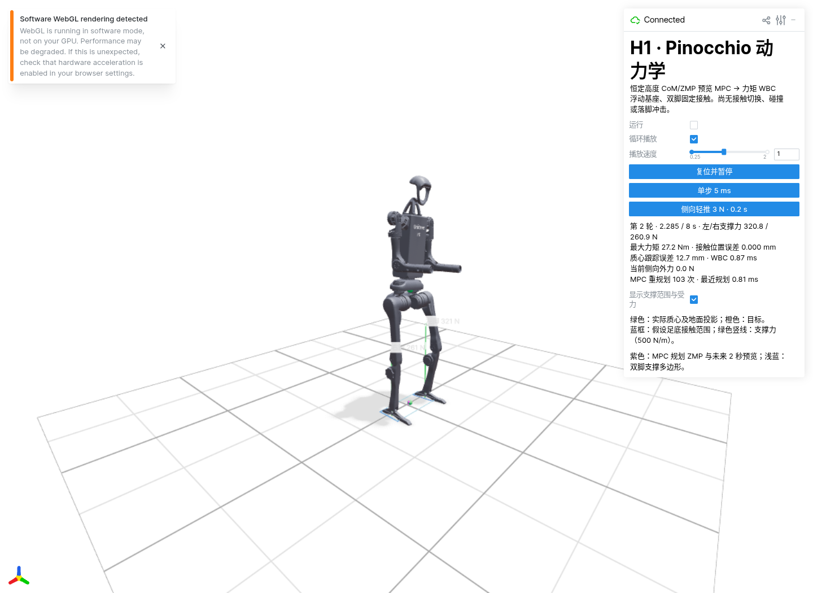
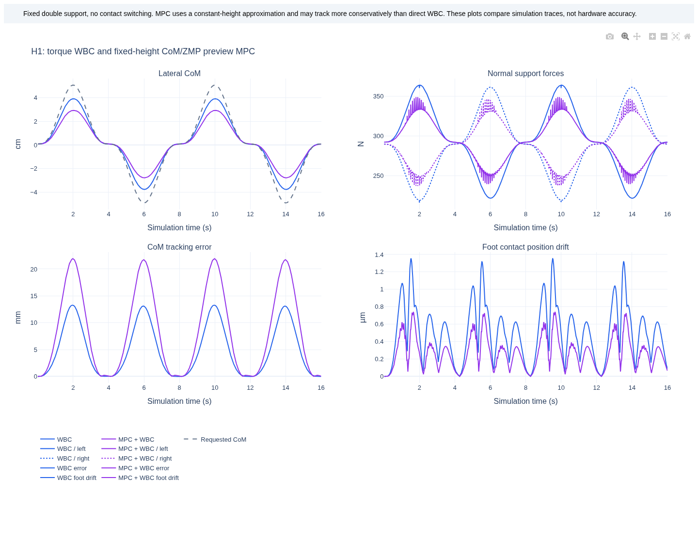
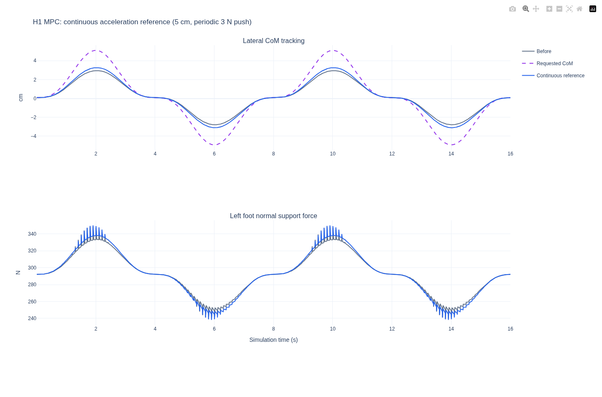
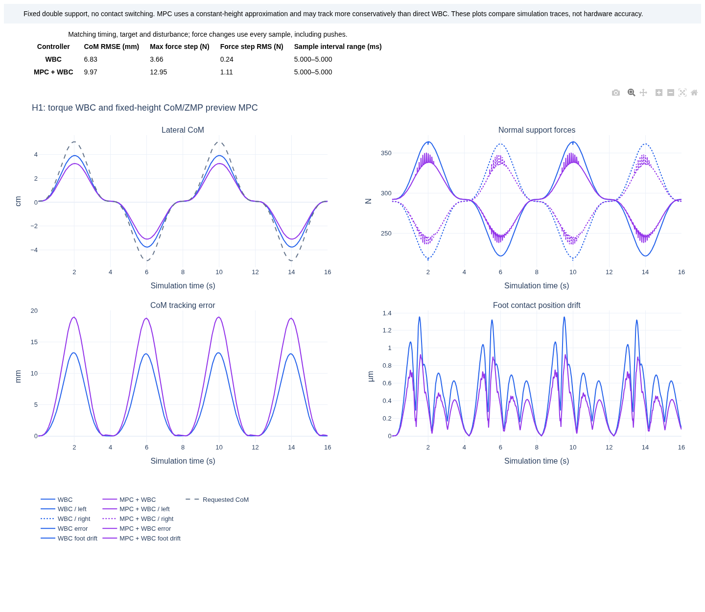

# H1 动力学演示优化记录 · 2026-09-14

本轮加入恒高度质心/ZMP 预览 MPC、耦合足底接触力约束和侧向扰动交互，保留直接 WBC 作为默认模式。两种模式都通过 Pinocchio 计算动力学，由关节力矩驱动约束正向动力学积分。

前面的数据记录首次一小时优化；后续加速度连续性改进及最新验证见文末，长测证据分别保留源文件哈希。

## 运行

在项目根目录、安装动力学和可视化依赖后运行（依赖说明见 [H1 动力学指南](h1_dynamics.md)）：

```bash
.venv/bin/python examples/python/h1_dynamics_wbc.py --controller mpc --viewer
```

默认自动运行并循环播放。面板支持暂停、5 ms 单步、复位、播放速度和 3 N / 0.2 s 侧向轻推。将 `mpc` 改成 `wbc` 可比较直接力矩 WBC；添加 `--push-force 3` 可周期性施加扰动。



## 控制和数值计算

- MPC 用 20 个 0.1 s 区间规划水平质心，每 0.1 s 重规划；WBC 按 5 ms 仿真步长跟踪。三次 Bernstein 控制点约束覆盖整个区间的 ZMP，终端捕获点保持在双脚支撑多边形内。
- 足底力锥从四角摩擦射线构造，联合限制剪切力、压力中心和扭转力矩。独立线性规划测试核对角点受力可实现性；正向动力学实际接触力仍在每步积分前检查。
- WBC 复用 OSQP 稀疏工作区，保持动态矩阵块的符号结构。固定自适应更新间隔，每步恢复初始 rho，减少求解过程对上一步数值状态的依赖。
- 遇到求解不准确或迭代上限，最多重建一次工作区；明确不可行立即停止。绝对约束验收阈值仍为 `1e-5`，没有放宽物理约束。重建次数在面板和报告中可见。
- 外力只进入被控系统的正向动力学；控制器通过状态反馈响应。扰动模式预留接触裕度。外力期间 WBC 预测加速度与实际加速度不必相等，实际动力学方程残差单独记录。

最终版本与本轮开始时保存的 `dynamics.py` 比较：默认无扰动 WBC 轨迹各运行 1600 步、交替顺序重复三次，平均完整计算步耗时从约 1.01 ms 降至 0.84 ms，中位总耗时比约 1.21 倍。每轮工作区创建从 1600 次减少到 1 次；该轨迹最大力矩差 `7.56e-13 Nm`、配置分量差 `3.65e-15`。这是本机短轨迹观测，不能推广到扰动 MPC 的最坏延迟。原始数据见 [性能 JSON](assets/h1_solver_benchmark.json)。

## 跟踪对比

同为 16 s、横向目标幅值 5 cm、周期性 3 N / 0.2 s 扰动：

| 指标 | 直接 WBC | MPC + WBC |
| --- | ---: | ---: |
| 质心跟踪 RMSE | 6.83 mm | 11.62 mm |
| 最大质心误差 | 13.28 mm | 21.95 mm |
| 最小单脚法向力 | 216.25 N | 237.58 N |
| 最大足底位置漂移 | 1.35 µm | 0.74 µm |

MPC 当前更保守，跟踪误差反而更大，不能据此宣称全面优于直接 WBC。曲线也显示重规划引起的支撑力波动，后续可继续改善加速度连续性与模型一致性。上述数值是同模型、固定接触、无噪声仿真的结果，不代表硬件精度。



原始汇总见 [对比 JSON](assets/h1_dynamics_comparison.json)。交互图需要额外的 Plotly，下面通过 `uv run --with plotly` 临时提供，不增加控制器运行依赖：

```bash
.venv/bin/python examples/python/h1_dynamics_wbc.py --controller wbc --steps 3200 --amplitude 0.05 --push-force 3 --csv /tmp/wbc.csv
.venv/bin/python examples/python/h1_dynamics_wbc.py --controller mpc --steps 3200 --amplitude 0.05 --push-force 3 --csv /tmp/mpc.csv
uv run --with plotly scripts/report_h1_dynamics.py --wbc /tmp/wbc.csv --mpc /tmp/mpc.csv --output /tmp/h1-report.html
```

## 验证及边界

Python 全量测试 325 项通过；wheel 构建与隔离目录导入通过。测试包括动力学一致性、连续区间 MPC 约束、耦合接触力锥、数值失败恢复和外力反馈。

两种模式均通过真实 Chromium/Viser 检查：加载、单步、连续循环、暂停、周期边界停止、轻推、复位及复位后单步；无浏览器异常。见 [WBC 浏览器结果](assets/h1_browser_wbc.json) 和 [MPC 浏览器结果](assets/h1_browser_mpc.json)。

最终代码的 MPC + WBC 完成 900 s / 180000 步长测（幅值 5 cm，周期性 3 N 轻推），实际耗时 521.9 s。实际接触约束违反量为零，最大足底漂移 0.738 µm，动力学残差不超过 `1.94e-12`。期间触发 11 次数值工作区重建，均通过约束验收；最慢 WBC 步约 124 ms，因此仍不能用于硬实时控制。峰值 RSS 从约 116 MiB 增长到 118 MiB，预热后稳定。详见带源文件哈希的 [最终 MPC 长测 JSON](assets/h1_mpc_soak_900s.json)。

本轮耦合接触模型版本的直接 WBC 完成 3600 s / 720000 步周期扰动长测，实际接触约束违反量为零；见 [WBC 长测 JSON](assets/h1_wbc_soak_3600s.json)。该报告的代码哈希对应加入最终数值重建策略之前的版本，不能当作最终求解策略的完整长测。

仿真步长 5 ms 不等于硬实时保证；个别 QP 求解和工作区重建耗时可能超过 5 ms。所有长测时间均为仿真时间，报告另列实际运行耗时。

复现最终长测和浏览器检查：

```bash
.venv/bin/python scripts/soak_h1_dynamics.py --controller mpc --push-force 3 --amplitude 0.05 --seconds 900 --output /tmp/h1-mpc-soak.json
.venv/bin/python scripts/check_h1_dynamics_browser.py --controller mpc --output /tmp/h1-browser-mpc
.venv/bin/python scripts/check_h1_dynamics_browser.py --controller wbc --output /tmp/h1-browser-wbc
.venv/bin/python scripts/benchmark_h1_dynamics.py --steps 1600 --repeats 3 --output /tmp/h1-benchmark.json
```

浏览器检查需要本机 Chromium、可视化依赖与本地端口权限。基准脚本加 `--reference /path/to/saved/dynamics.py` 可比较保存的旧实现；不传时仅测当前版本。

当前双脚固定接触，尚无抬脚落脚、接触切换、碰撞或 MuJoCo；这仍是站立重心转移与轻推恢复演示，不能称为动力学行走。原有弯腰、拾取及 march 入口仍是运动学演示。

## 后续优化：MPC 参考加速度连续性

重规划继续使用实际位置和速度反馈，但参考加速度从上一段计划延续。此前每次用实际加速度重置该参考，增加了周期性的控制变化。新的初值仍必须通过相同的支撑、速度、加速度及 jerk 约束；不可行时回退到实际加速度重试一次，两次均失败就暂停。回退次数记录在 `mpc_continuity_fallbacks`，复位清零。

相同的 16 s、5 cm 幅值、周期性 3 N / 0.2 s 轻推对比：

| 指标 | 修改前 MPC | 连续参考 MPC |
| --- | ---: | ---: |
| 质心 RMSE | 11.62 mm | 9.97 mm |
| 单步法向支撑力最大变化 | 17.24 N | 12.95 N |
| 单步法向支撑力变化 RMS | 1.50 N | 1.11 N |
| 实际接触约束违反量 | 0 | 0 |

支撑力变化按左右脚相邻 5 ms 样本共同统计，包括轻推开始和结束。跟踪 RMSE 改善约 14%，最大单步变化降低约 25%；支撑力仍有波动，不能认为已经消除。直接 WBC 的同场景 RMSE 为 6.83 mm，仍低于本次 MPC。



见带入口源文件哈希的 [对比 JSON](assets/h1_mpc_continuity_comparison.json)。最新全量测试 **329 项通过**，新增测试覆盖参考连续性、实际位置/速度反馈、不可行回退、两次失败停止及带扰动的跟踪/支撑力回归。

浏览器检查改为先暂停并单步确认轻推生效，再继续验证外力结束，避免机器繁忙时轮询漏过整个 0.2 s 脉冲。
两种模式均通过更新后的检查，默认模式结果见 [WBC 浏览器 JSON](assets/h1_wbc_continuity_browser.json)。

连续参考版本完成 **300 s / 60000 步**、5 cm 幅值、周期性 3 N 轻推长测：实际接触约束违反量为零，最大足底漂移 0.925 µm；MPC 连续性回退为零，WBC 数值工作区重建 5 次。最慢 WBC 步约 124 ms，仍无硬实时保证。见 [长测 JSON](assets/h1_mpc_continuity_soak.json) 和 [MPC 浏览器结果](assets/h1_mpc_continuity_browser.json)。本次没有将上一版本的 900 s 长测计作新版本证据。

## 提交前的报告与构建完善

对比工具现在拒绝采样时间、目标轨迹或施加外力不一致的两个 CSV，并在 HTML/JSON 中列出原始样本的支撑力最大变化、变化 RMS 和采样间隔范围。最新 [对比数据](assets/h1_release_comparison.json) 和下图使用相同的 16 s、5 cm、周期性 3 N 场景。此轮完善比较方法，没有进一步改变控制器轨迹。



提交前验证：Python 全量 **337 项通过**，C++ 构建与 **8 项 CTest 通过**，wheel 构建通过。C++ 运行时测试补齐模拟后端构造函数、修正 `CycleResult.control.command` 字段访问，并对累计时间使用浮点容差。
