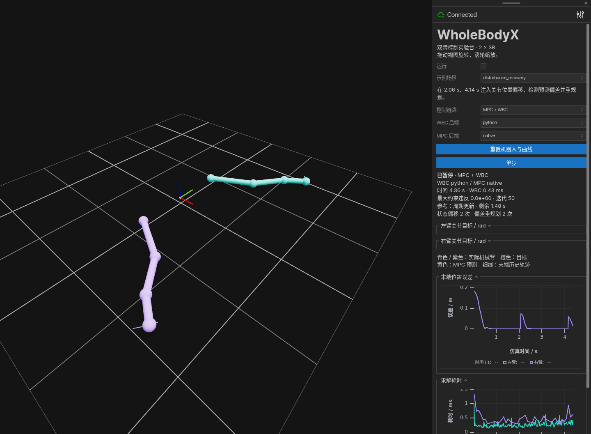

# 验证记录

日期：2026-09-05。验证环境为 Linux x86_64、GCC 12.3、Python 3.11。

| 检查 | 结果 |
| --- | --- |
| Python / native 参数化测试 | 183 项全部通过，无跳过；新增关节排列、任务残差、不对称约束、轨迹/命令转换及 URDF 重排检查 |
| CTest | 7 项通过：控制测试、关节映射测试和 5 个带验收条件的独立 C++ 示例 |
| 独立 C++ MPC → WBC 示例 | 250 个控制步骤完成，关节目标误差低于 `1e-3` rad |
| Conan 包创建与 test_package | 构建、安装、下游链接和执行通过 |
| Python wheel / sdist | 构建成功 |
| native wheel / sdist | 构建成功，wheel 平台为 `cp311-linux_x86_64` |
| 独立临时环境安装两个 wheel | 本轮验证四种 WBC/MPC 重排组合及两种后端的协作轨迹；此前已验证 400 步 CSV 导出 |
| 浏览器实际渲染与交互 | 本轮 3 组关节映射示例检查通过；上一轮 18 组通用/自定义后端检查通过 |
| 实时曲线 | 两张曲线均有采样数据及有限的有效横轴范围，浏览器无运行时异常 |

数值基线：250 步、每步 0.02 s 的平面双臂积分仿真，初始两末端位置误差之和约
`0.373 m`。独立 wheel 环境中 Python WBC 最终误差约 `4.24e-10 m`，
native MPC → WBC 最终误差低于 `1e-12 m`。这是理想积分模型与可达静态目标的测试结果，
不代表真实机器人精度、模型误差下的性能或最坏执行时间。

测试复现入口：

```bash
uv sync --locked --extra urdf --extra viz
bash scripts/build.sh --python
PYTHONPATH=build/native WBX_REQUIRE_NATIVE=1 .venv/bin/python -m pytest -q
./build/native/wbx_joint_control
conan create . -pr:h profiles/linux-gcc12-release -pr:b profiles/linux-gcc12-release --lockfile=conan.lock
```

浏览器验证使用 Viser 1.1.0 和 Chrome，通过实际 DOM 操作确认控制状态变化，
并检查 uPlot 数据与轴范围。截图如下：



场景基线与接入验证：

| 场景 | 验证结果 |
| --- | --- |
| 末端圆轨迹，8 s | 最大位置误差约 `4.04e-5 m`，最大朝向误差约 `2.10e-6 rad` |
| 双臂协作，8 s | 最大相对位置误差约 `1.00e-5 m`；不约束末端朝向 |
| MPC 在线换目标，8 s | 两次目标切换被检测并及时重规划，最终位置误差低于 `1e-4 m` |
| 四种 WBC/MPC 后端组合 | 最终误差一致性阈值 `2e-6 m`，全部通过 |
| 限位与故障恢复 | 位置停在 1 rad；矛盾状态返回 `infeasible` 且无命令，恢复后速度指向边界内 |
| 自带 3R URDF | 最终位置和朝向误差均低于 `1e-4`，Python/native 均通过 |
| C++ 非周期换目标 | 2.06 s、4.14 s 触发额外求解；共 82 次重规划 |
| 状态偏移恢复，8 s | 四种后端组合均检测 2 次偏移，并触发 2 次 `tracking_error` 重规划；最终位置误差低于 `1e-4 m` |
| 参考拒绝与失效 | 陈旧、未来、起点错误、维度错误、有效期不足、位置/速度/速度差越界的计划均被拒绝 |
| CSV 偏移记录 | 完整记录状态跳变量；`q[k]-q[k-1] = offset[k] + dt*v[k]` 验证通过 |
| 自定义后端工厂 | 两个不同注册名分别提供 WBC/MPC；8 s 内检测并恢复两次状态偏移 |
| 后端重配置失败 | 工厂加载错误保留原控制器、规划器、状态和有效计划，不自动更换算法 |
| 安装包运行与依赖诊断 | `wholebodyx` 命令可在仓库外运行；缺少 URDF/viz 不阻断基础运行，显式要求缺失能力时返回非零 |
| 不同关节排列的协作轨迹 | Python 最大关节位置差约 `3.09e-7 rad`、速度差约 `1.55e-5 rad/s`、末端位置差约 `2.88e-9 m` |
| 不同关节排列的 MPC → WBC | 四种语言组合均完成两次偏移恢复，逐步关节/末端轨迹对比通过 |
| URDF 后端顺序参数 | `wrist_joint shoulder elbow` 与模型原顺序均收敛，Python/native 均通过 |
| Conan 新接口消费 | 下游包含 `joint_order.hpp`，构造适配器并验证不对称速度边界的执行结果 |

新增脚本及验收说明见 [examples/README.md](../examples/README.md)。
CSV 保存完整运行采样，不受 viewer 最近 300 点的显示窗口限制。
MPC 性能优化的前后测量、初始化开销及复现脚本见 [性能记录](performance.md)。
本轮新增 C++ / Python 关节顺序适配，已重建 C++ 库、Python/native wheel 和源码包，
并重新验证 Conan 下游链接及调用。独立 wheel 环境未安装 Pinocchio/Viser，仍可执行重排后的闭环。
接入方式见 [integration.md](integration.md)，映射与数值阈值见 [joint_order.md](joint_order.md)，
参考调度见 [runtime.md](runtime.md)。
上一轮完成通用场景 15 组与自定义后端 3 组浏览器检查。当前轮次补测关节重排的 MPC → WBC、
两次状态偏移恢复与有效曲线、Cartesian 场景切换并返回 MPC，共 3 组，无 JavaScript 运行异常。

当前验证没有覆盖真实硬件、动态接触、浮动基座、碰撞约束和其他操作系统。
